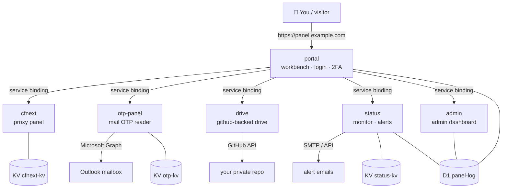

# cf-panel

English | [简体中文](README.zh-CN.md)

[](LICENSE)
[](https://workers.cloudflare.com/)
[](DEPLOY.md)
[](../../pulls)

A **self-hosted personal panel** running entirely on [Cloudflare Workers](https://workers.cloudflare.com/) — no VPS, no Docker, no server to maintain. One login gives you a **VLESS / Trojan / Shadowsocks proxy panel**, an **Outlook verification-code reader**, a **private file drive** (backed by your own GitHub repo), an **uptime & security monitor**, and an **admin dashboard**, all wired together with service bindings, KV and D1.

> **New here?** Start with the [step-by-step deploy guide](DEPLOY.md) — about 30–60 minutes from zero to a running panel on your own domain.
> **Prefer AI help?** Copy the prompt in [AI_DEPLOY.md](AI_DEPLOY.md) into any AI assistant and let it walk you through the deploy.

---

## ✨ Features

### 🛡️ portal — Workbench (the front door)
- Password + **TOTP two-factor** login, Turnstile bot check, brute-force lockout (8 fails / 15 min)
- "Log out all devices" session kill-switch, login alerts for new IPs/devices
- Read-only **guest links** — share your proxy subscription with family/friends, revoke anytime
- Recovery codes, CSRF protection, strict CSP headers

### 📡 cfnext — Proxy panel (VLESS / Trojan / Shadowsocks)
- Per-user subscription URLs + inline QR codes
- **Preferred-IP optimizer** with latency testing and scheduled auto-refresh
- Outbound chaining (`socks5://`, `http://`, `ss://`), ECH, custom SNI/Host/ALPN
- Trojan protocol support, node health dashboard, traffic stats
- Encrypted config versioning with one-click rollback
- First visit forces an admin password — no default credentials, ever

### 📧 otp-panel — Mailbox verification codes
- Polls your **Outlook** inbox via Microsoft Graph (OAuth, auto-rotating refresh token)
- Extracts 4–8 digit codes from any sender, with sender/subject filters
- **Auto-translates** code emails (Google first, Workers AI fallback)
- `/api/latest` endpoint so the workbench can pop the newest code

### 💾 drive — Private file drive
- Small files stored in **your own private GitHub repo** (via the GitHub API)
- Upload / download / delete through the workbench UI

### 📊 status — Monitor & alerts
- Health checks every 5 minutes: cfnext, drive, otp + the portal itself
- **Email alerts** on down/recovery (rate-limited, no spam)
- Suspicious-IP log, bot/crawler stats, WAF event view
- TLS certificate & domain health checks (expiry, NS delegation, parent-domain status)

### 🔧 admin — Admin dashboard
- API token inventory with risk notes, audit log (who changed DNS/tunnels/rules, logins)
- Proxy node dashboard: subscription pulls, traffic, source IPs, failover log
- CFNext config version history, outbound pool management, guest management

---

## 🏗️ Architecture



Everything runs at the edge. Workers talk to each other over **service bindings** (no public HTTP between them); the only public surface is the `portal` worker on your domain.

**Data layer**

| Store | Used for |
|---|---|
| KV `cfnext-kv` | Proxy panel config, subscription issuance records |
| KV `otp-kv` | Rotating Microsoft refresh token, access-token cache |
| KV `status-kv` | Security counters and events |
| D1 `panel-log` | Health history, login audit, sessions, TOTP, guests, config versions, mail outbox… (tables auto-created on first run) |

---

## 🚀 Quick start

```bash
# 1. create storage
wrangler kv namespace create CFNEXT_KV
wrangler kv namespace create OTP_KV
wrangler kv namespace create STATUS_KV
wrangler d1 create panel-log

# 2. fill the YOUR_*_ID placeholders in workers/*/wrangler.toml

# 3. deploy (order matters — service bindings need targets to exist)
for w in cfnext drive otp-panel status admin portal; do
  ( cd workers/$w && wrangler deploy )
done

# 4. set secrets (full list in each wrangler.toml header + DEPLOY.md)
cd workers/portal && wrangler secret put PASSWORD
```

Then bind your domain to the `portal` worker and open it. Full walkthrough — including the Microsoft OAuth app for the OTP reader, the GitHub token for the drive, and Turnstile setup — is in **[DEPLOY.md](DEPLOY.md)**.

---

## ⚙️ Configuration reference

Secrets are set with `wrangler secret put <NAME>` inside each worker's directory. Plain-text vars go in `wrangler.toml`.

### portal

| Name | Type | Purpose |
|---|---|---|
| `PASSWORD` | secret | Workbench login password |
| `SESSION_SECRET` | secret | Session signing key (random 32 bytes) |
| `SVC_KEY` | secret | **Shared** inter-service trust key — same value on portal, admin, status, drive, otp-panel |
| `ADMIN_SVC_KEY` | secret | Internal key for the admin backend |
| `TOTP_KEY` | secret | Encrypts TOTP secrets + recovery-code hashes |
| `TURNSTILE_SECRET` | secret | Cloudflare Turnstile secret (login bot check) |
| `PANEL` | secret | Fallback proxy-panel path (KV `config.path` wins) |

### cfnext (proxy panel)

| Name | Type | Purpose |
|---|---|---|
| `U` | var | **VLESS UUID** (required; also the panel URL path unless `PATH` is set) |
| `PATH` | var | Custom panel path (optional) |
| `ADMIN` | var | Admin password (forced setup on first visit if unset) |
| `HOST` | var | Custom SNI / Host (defaults to the worker hostname) |
| `PROXYIP` | var | Fixed egress IP (`host` or `host:port`) |
| `S` / `OUTBOUND` | var | Outbound proxy (`socks5://`, `http://`, `ss://`, `host:port`) |
| `ECH` | var | `true`/`1` enables ECH |
| `TROJAN` | var | `true`/`1` enables Trojan (`TROJAN_PASSWORD` required) |
| `ALPN` | var | Custom ALPN |
| `YX` | var | Preferred IP list (`IP:port#name`, comma-separated) |
| `BESTIP_AUTO` | var | `1` enables scheduled auto-optimization (needs a cron trigger) |

### otp-panel (mail codes)

| Name | Type | Purpose |
|---|---|---|
| `MS_CLIENT_ID` | var | Microsoft OAuth app (client) ID |
| `MS_REFRESH_TOKEN` | secret | OAuth refresh token (`Mail.Read` + `offline_access`) — auto-rotated daily by the `17 3 * * *` cron |
| `FORWARD_TO` | var | Optional forward address |
| `SVC_KEY` | secret | Same shared inter-service key |

### drive

| Name | Type | Purpose |
|---|---|---|
| `GH_TOKEN` | secret | GitHub personal access token with `repo` scope (reads/writes your private drive repo) |
| `SVC_KEY` | secret | Same shared inter-service key |

Set `OWNER` / `REPO` at the top of `workers/drive/worker.js` to your GitHub username and private repo name.

### status (monitor)

| Name | Type | Purpose |
|---|---|---|
| `CF_ZONE_ID` | var | Your Cloudflare zone ID (domain health checks) |
| `SVC_KEY` | secret | Same shared inter-service key |
| `CF_ANALYTICS_TOKEN` | secret | Read-only API token for Account Analytics |
| `CI_REPORT_KEY` / `CI_WRITE_KEY` | secret | Keys for external CI reporting / remediation |
| `CONFIG_KEY` / `GUARD_TOKEN` | secret | Config encryption / token-abuse auto-response |
| `OUTBOUND_POOL_JSON` / `OUTBOUND_POOL_KEY` | secret | Outbound proxy pool config + encryption key |

Cron: `*/5 * * * *` (health checks + alerting).

### admin

| Name | Type | Purpose |
|---|---|---|
| `SVC_KEY` | secret | Same shared inter-service key |
| `ADMIN_RO_TOKEN` | secret | Read-only token for the admin pages |
| `CONFIG_KEY` / `CSRF_KEY` | secret | Config encryption / form CSRF signing |
| `OUTBOUND_POOL_JSON` / `OUTBOUND_POOL_KEY` | secret | Same pool as status |

---

## 🧰 Tech stack

- **Runtime:** Cloudflare Workers (ES modules), `compatibility_date 2026-01-20`
- **Bindings:** Service bindings (worker-to-worker), KV, D1, Workers AI
- **Auth:** Password + TOTP (RFC 6238), HMAC-signed sessions, Turnstile
- **Mail:** Microsoft Graph API (OAuth2 refresh-token rotation)
- **Storage:** GitHub REST API (drive), D1 (SQLite at the edge)
- **Deploy:** Wrangler (no build step — plain JavaScript)

---

## ❓ FAQ

**Does anything run on a server I maintain?**
No. All six workers run on Cloudflare's edge. The only things you own are the Cloudflare account, the domain, and the GitHub repo used as drive storage.

**Where are secrets stored?**
In Cloudflare Worker secrets (encrypted at rest) and your own environment. This repo contains zero real credentials — only `YOUR_*` placeholders.

**Can I use only the proxy panel?**
Yes. `cfnext` is fully standalone: it needs just one KV namespace and the `U` variable.

**How does the OTP reader keep working?**
`otp-panel` redeems its Microsoft refresh token on every use and stores the rotated token in KV; a daily cron refreshes it so it never expires from inactivity.

**I found a bug / have an idea.**
[Open an issue](../../issues) or send a PR — both welcome.

---

## 🤝 Contributing

1. Fork the repo, create a feature branch.
2. Keep secrets out of the code — new credentials must go through `env.*` bindings with `YOUR_*` placeholders and be documented in the config table above.
3. Test with `wrangler dev` before opening a PR.

## 📄 License

[MIT](LICENSE) — do whatever you want, just keep the copyright notice.
