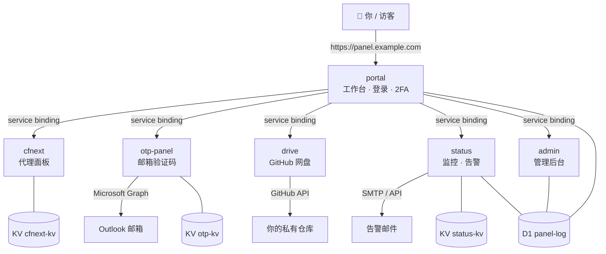

# cf-panel

[](LICENSE)
[](https://workers.cloudflare.com/)
[](DEPLOY.md)
[](../../pulls)

[English](README.md) | 简体中文

一套完全跑在 [Cloudflare Workers](https://workers.cloudflare.com/) 上的**个人面板系统**——不用 VPS、不用 Docker、不用维护服务器。一次登录，即可使用 **VLESS / Trojan / Shadowsocks 代理面板**、**Outlook 邮箱验证码读取**、**私有网盘**（文件存在你自己的 GitHub 仓库）、**在线状态与安全监控**、**管理后台**，全部通过 service binding、KV 和 D1 连在一起。

> **第一次来？** 先看[从零部署指南](DEPLOY.md)——大约 30–60 分钟，就能在你自己的域名上跑起来。

---

## ✨ 功能一览

### 🛡️ portal — 工作台（入口）
- 密码 + **TOTP 两步验证**登录，Turnstile 人机验证，暴力破解锁定（15 分钟内输错 8 次锁定）
- "下线所有设备"一键踢人，新 IP / 新设备登录发邮件提醒
- 只读**访客链接**——把代理订阅分享给家人朋友，随时撤销
- 恢复码、CSRF 防护、严格的 CSP 安全头

### 📡 cfnext — 代理面板（VLESS / Trojan / Shadowsocks）
- 按用户生成订阅链接 + 内联二维码
- **优选 IP**：延迟测速、定时自动刷新最优 IP
- 出站串联（`socks5://`、`http://`、`ss://`）、ECH、自定义 SNI / Host / ALPN
- Trojan 协议支持、节点健康仪表盘、流量统计
- 配置加密存版本，一键回滚
- 首次访问强制设置管理密码——没有默认密码

### 📧 otp-panel — 邮箱验证码
- 通过 Microsoft Graph（OAuth，refresh token 自动轮换）轮询你的 **Outlook** 收件箱
- 从任意发件人邮件中提取 4–8 位验证码，支持发件人/关键词过滤
- **自动翻译**验证码邮件（优先 Google，失败回退 Workers AI）
- 提供 `/api/latest` 接口，工作台可直接弹出最新验证码

### 💾 drive — 私人网盘
- 小文件存在**你自己的 GitHub 私有仓库**（走 GitHub API）
- 在工作台里上传 / 下载 / 删除

### 📊 status — 状态监控与告警
- 每 5 分钟巡检：cfnext、drive、otp 以及工作台自身
- **邮件告警**：离线/恢复通知（限流，不会轰炸）
- 可疑 IP 记录、爬虫统计、WAF 事件查看
- TLS 证书与域名健康检查（到期时间、NS 委派、上级域名状态）

### 🔧 admin — 管理后台
- API 令牌清单（含风险提示）、审计日志（谁改了 DNS / 隧道 / 规则、登录记录）
- 代理节点仪表盘：订阅拉取、流量、来源 IP、故障切换记录
- CFNext 配置版本历史、出站代理池管理、访客管理

---

## 🏗️ 架构



全部跑在边缘节点上。Worker 之间通过 **service binding** 直接互调（不走公网 HTTP）；唯一对外暴露的是你域名上的 `portal`。

**数据层**

| 存储 | 用途 |
|---|---|
| KV `cfnext-kv` | 代理面板配置、订阅签发记录 |
| KV `otp-kv` | 微软 refresh token（轮换）、access token 缓存 |
| KV `status-kv` | 安全计数器与事件 |
| D1 `panel-log` | 健康历史、登录审计、会话、TOTP、访客、配置版本、邮件发件箱……（表结构首次运行时自动创建） |

---

## 🚀 快速开始

```bash
# 1. 创建存储
wrangler kv namespace create CFNEXT_KV
wrangler kv namespace create OTP_KV
wrangler kv namespace create STATUS_KV
wrangler d1 create panel-log

# 2. 把 workers/*/wrangler.toml 里的 YOUR_*_ID 占位符换成真实 ID

# 3. 依次部署（顺序重要——service binding 要求被引用的先存在）
for w in cfnext drive otp-panel status admin portal; do
  ( cd workers/$w && wrangler deploy )
done

# 4. 设置密钥（完整清单在每个 wrangler.toml 头部注释和 DEPLOY.md 里）
cd workers/portal && wrangler secret put PASSWORD
```

然后把你的域名绑定到 `portal` Worker，打开即可。完整流程——包括验证码用的微软 OAuth 应用、网盘用的 GitHub Token、Turnstile 配置——都在 **[DEPLOY.md](DEPLOY.md)**。

---

## ⚙️ 配置参考

密钥用 `wrangler secret put <NAME>` 在各自 Worker 目录下设置；明文变量写在 `wrangler.toml` 里。

### portal（工作台）

| 名称 | 类型 | 用途 |
|---|---|---|
| `PASSWORD` | secret | 工作台登录密码 |
| `SESSION_SECRET` | secret | 会话签名密钥（随机 32 字节） |
| `SVC_KEY` | secret | **共用的**内部服务互信密钥——portal、admin、status、drive、otp-panel 用同一个值 |
| `ADMIN_SVC_KEY` | secret | 管理后台内部互信密钥 |
| `TOTP_KEY` | secret | 加密 TOTP 密钥用 |
| `TURNSTILE_SECRET` | secret | Cloudflare Turnstile 密钥（登录人机验证） |
| `PANEL` | secret | 代理面板路径回退值（以 KV `config.path` 为准） |

### cfnext（代理面板）

| 名称 | 类型 | 用途 |
|---|---|---|
| `U` | var | **VLESS UUID**（必填；同时是面板 URL 路径，除非设置了 `PATH`） |
| `PATH` | var | 自定义面板路径（可选） |
| `ADMIN` | var | 管理密码（未设置时首次访问强制设置） |
| `HOST` | var | 自定义 SNI / Host（默认 Worker 域名） |
| `PROXYIP` | var | 固定出口 IP（`host` 或 `host:port`） |
| `S` / `OUTBOUND` | var | 出站代理（`socks5://`、`http://`、`ss://`、`host:port`） |
| `ECH` | var | `true`/`1` 开启 ECH |
| `TROJAN` | var | `true`/`1` 开启 Trojan（需配 `TROJAN_PASSWORD`） |
| `ALPN` | var | 自定义 ALPN |
| `YX` | var | 优选 IP 列表（`IP:port#名称`，逗号分隔） |
| `BESTIP_AUTO` | var | `1` 开启定时自动优选（需配 cron 触发器） |

### otp-panel（邮箱验证码）

| 名称 | 类型 | 用途 |
|---|---|---|
| `MS_CLIENT_ID` | var | 微软 OAuth 应用的客户端 ID |
| `MS_REFRESH_TOKEN` | secret | OAuth refresh token（`Mail.Read` + `offline_access` 权限），每天 03:17 的 cron 自动轮换，永不过期 |
| `FORWARD_TO` | var | 可选的转发地址 |
| `SVC_KEY` | secret | 同上，共用的内部互信密钥 |

### drive（网盘）

| 名称 | 类型 | 用途 |
|---|---|---|
| `GH_TOKEN` | secret | 有 `repo` 权限的 GitHub Personal Access Token（读写网盘仓库用） |
| `SVC_KEY` | secret | 同上，共用的内部互信密钥 |

`workers/drive/worker.js` 顶部的 `OWNER` / `REPO` 改成你的 GitHub 用户名和私有仓库名。

### status（监控）

| 名称 | 类型 | 用途 |
|---|---|---|
| `CF_ZONE_ID` | var | 你的 Cloudflare Zone ID（域名健康检查用） |
| `SVC_KEY` | secret | 同上，共用的内部互信密钥 |
| `CF_ANALYTICS_TOKEN` | secret | 只读的 API Token（读 Account Analytics） |
| `CI_REPORT_KEY` / `CI_WRITE_KEY` | secret | 外部 CI 上报 / 修复操作的密钥 |
| `CONFIG_KEY` / `GUARD_TOKEN` | secret | 配置加密 / 令牌异常自动处置 |
| `OUTBOUND_POOL_JSON` / `OUTBOUND_POOL_KEY` | secret | 出站代理池配置与加密密钥 |

Cron：`*/5 * * * *`（健康检查 + 告警）。

### admin（管理后台）

| 名称 | 类型 | 用途 |
|---|---|---|
| `SVC_KEY` | secret | 同上，共用的内部互信密钥 |
| `ADMIN_RO_TOKEN` | secret | 管理页只读令牌 |
| `CONFIG_KEY` / `CSRF_KEY` | secret | 配置加密 / 表单 CSRF 签名 |
| `OUTBOUND_POOL_JSON` / `OUTBOUND_POOL_KEY` | secret | 同 status 的出站代理池 |

---

## 🧰 技术栈

- **运行时：** Cloudflare Workers（ES modules），`compatibility_date 2026-01-20`
- **互联：** Service bindings（Worker 间直调）、KV、D1、Workers AI
- **认证：** 密码 + TOTP（RFC 6238）、HMAC 签名会话、Turnstile
- **邮件：** Microsoft Graph API（OAuth2 refresh token 轮换）
- **存储：** GitHub REST API（网盘）、D1（边缘 SQLite）
- **部署：** Wrangler（纯 JavaScript，无构建步骤）

---

## ❓ 常见问题

**需要自己维护服务器吗？**
不需要。6 个 Worker 全跑在 Cloudflare 边缘节点上。你只需要有 Cloudflare 账户、一个域名，以及一个存网盘文件的 GitHub 仓库。

**密钥存在哪？**
存在 Cloudflare Worker secrets（加密存储）和你自己的环境变量里。这个仓库里没有任何真实凭据，只有 `YOUR_*` 占位符。

**能只用代理面板吗？**
可以。`cfnext` 是完全独立的：只需要 1 个 KV 命名空间和 `U` 变量。

**验证码功能怎么保活？**
`otp-panel` 每次使用都会换新的微软 refresh token 存进 KV，每天 03:17 的 cron 也会刷一次，永不过期。

**发现 bug / 有想法？**
欢迎[提 issue](../../issues) 或 PR。

---

## 🤝 参与贡献

1. Fork 本仓库，新建分支开发。
2. 不要把密钥写进代码——新增凭据一律走 `env.*` 注入，占位符用 `YOUR_*`，并在上面的配置表里补文档。
3. 提 PR 前先用 `wrangler dev` 跑通。

## 📄 开源协议

[MIT](LICENSE)——保留版权声明即可任意使用。
